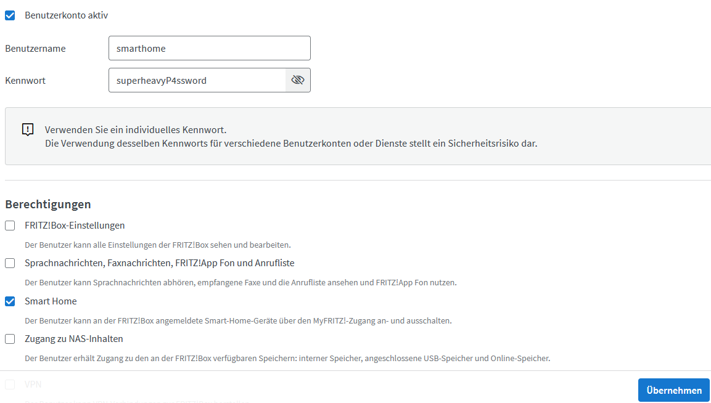
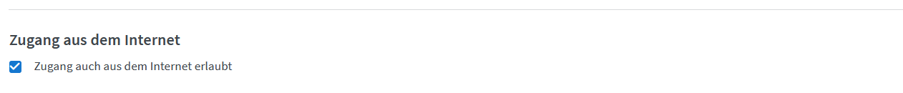
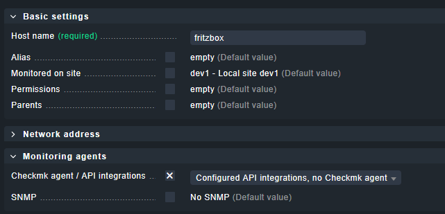
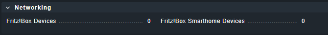
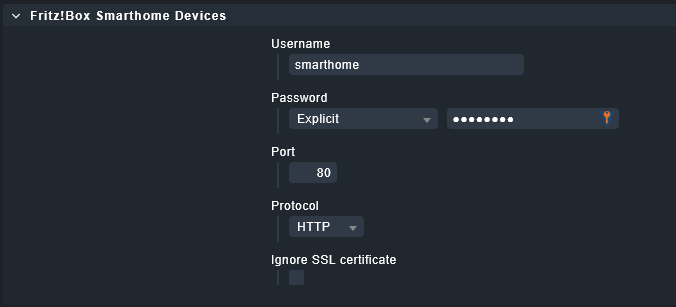
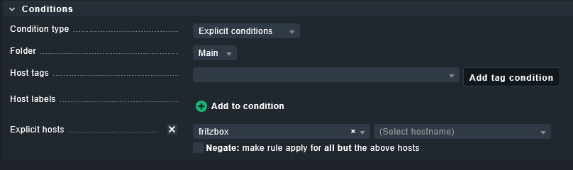

# checkmk_fritzbox_smarthome

A [Checkmk](https://checkmk.com/) extension to monitor smart home devices connected to a
[FRITZ!Box](https://fritz.com) (formerly AVM). Written for Checkmk 2.4 using the
`agent_based.v2`, `rulesets.v1` and `server_side_calls.v1` plugin APIs.

The special agent logs in to the FRITZ!Box via `login_sid.lua` (PBKDF2 challenge-response,
MD5 fallback for FRITZ!OS older than 7.24) and reads the device list from the AHA-HTTP interface.
Every smart home device becomes one service.

## Supported devices

| Device | Monitored values |
| --- | --- |
| [FRITZ!DECT Repeater 100](https://fritz.com/produkte/smart-home/fritzdect-repeater-100/) | presence, temperature with optional levels |
| [FRITZ!Smart Energy 200](https://fritz.com/produkte/smart-home/fritzsmart-energy-200/) / [210](https://fritz.com/produkte/smart-home/fritzsmart-energy-210/) (switchable outlets) | switch state, power, energy, voltage, temperature with optional levels |
| [FRITZ!Smart Thermo 301](https://fritz.com/produkte/smart-home/fritzdect-301/) / [302](https://fritz.com/produkte/smart-home/fritzsmart-thermo-302/) (radiator thermostats) | actual/target temperature with deviation thresholds, comfort/eco temperature, battery with thresholds, window open, summer mode, error state |
| [FRITZ!Smart Control 350](https://fritz.com/produkte/smart-home/fritzsmart-control-350/) (door/window contact) | contact open/closed, battery |
| FRITZ!Smart Control 400 (button) / [440](https://fritz.com/produkte/smart-home/fritzsmart-control-440/) (4-way button) | temperature with optional levels, humidity (440), battery |

Not yet supported: [FRITZ!Smart Energy 250](https://fritz.com/produkte/smart-home/fritzsmart-energy-250/),
[FRITZ!Smart Gateway](https://fritz.com/produkte/smart-home/fritzsmart-gateway/) and ZigBee devices behind it.

## Installation

Install the MKP from the releases page via *Setup → Extension packages* or `mkp install`.

## Setup

1. Create a dedicated user on the FRITZ!Box (*System → FRITZ!Box-Benutzer*) with the
   permission *Smart Home*. Access from the internet is only needed if Checkmk reaches the box from
   outside your LAN.

   
   

2. Add the FRITZ!Box as a host in Checkmk. Set *Checkmk agent / API integrations* to
   *Configured API integrations, no Checkmk agent* unless you also run an agent there.

   

3. Create a rule *Fritz!Box Smarthome Devices* under *Setup → Agents → Other integrations*
   with the user and password from step 1.

   
   
   

4. Run a service discovery on the host.

Thresholds (temperature deviation and battery of thermostats, humidity, upper/lower temperature
levels of other devices) and the handling of offline devices are configured in the rule
*Settings for Fritz!Box Smarthome Devices* (*Service monitoring rules*). Temperature levels for
non-thermostat devices are off unless configured.

The *Login method* in the agent rule defaults to *Automatic*: PBKDF2 when the box offers it
(FRITZ!OS 7.24 and newer), MD5 otherwise. Set it to a fixed method only if the automatic detection
fails for your box. Rules created with version 2.0.x do not need to be touched.

## Notes

* HAN-FUN units (sub units of a HAN-FUN device) are not discovered, they carry no own data.
* In summer mode or with the thermostat set to "off"/"on" the target temperature is not
  reported as a metric and the deviation is not checked.
* Debugging hints are in [.docs/debugging.md](.docs/debugging.md).
